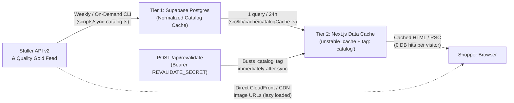

# Coddingtown Jewelers — Supplier APIs, Caching, Storage & Security Guide

> **Purpose:** A complete technical reference for setting up Stuller and Quality Gold catalog integrations, understanding the multi-tier caching layer and Supabase storage footprint, and reviewing our dependency and vulnerability posture.

---

## 1. Stuller & Quality Gold APIs: Capabilities & Setup

Because the site intentionally **omits online ordering and retail pricing**—displaying exact manufacturer **Item #s (`supplier_sku`)** so customers can call or visit the store—we only need product metadata, attributes, and photography. We never pull or store pricing, wholesale cost, or margin data.

### 1.1 Stuller API v2 (`src/lib/suppliers/stuller.ts`)
* **Protocol:** Official REST API (`POST https://api.stuller.com/v2/products`) returning JSON over HTTPS using **HTTP Basic Auth**.
* **What it allows us to get:**
  * **Identifiers & Variant Grouping:** `SKU` (e.g., `309:77802:S`), internal `Id`, `GroupDescription` (used alongside the SKU prefix to derive a shared `group_code` like `ST-309-77802` so metal/size variations group onto one card).
  * **Copy & Categorization:** `ShortDescription`, `Description`, `MerchandisingArea` (e.g., `Bridal`, `Jewelry`), and `MerchandisingCategory1` through `MerchandisingCategory5`.
  * **Structured Specs:** `DescriptiveElementGroup.DescriptiveElements[]` (`Metal Type`, `Quality`, `Primary Stone`, `Stone Shape`, `Finish`, `Weight`, etc.).
  * **Media Assets:** `Images[]` hosted on Stuller's AWS CloudFront CDN with `ThumbnailUrl`, `FullUrl`, `ZoomUrl`, `Angle`, and `SortOrder`.
  * **Lifecycle Flags:** `Status` and `Orderable` (used to mark discontinued pieces `is_active = false`).
  * *(Available on Stuller API v2 if ever needed later: Virtual Product API `api/v2/products/virtual` for 3C customizable mountings, and Gem API `api/v2/gem` for certified diamonds/gemstones.)*
* **Stuller Best Practice:** Stuller explicitly advises **against** calling their API on live frontend page loads. Our sync script pulls in batches and caches into Supabase.

#### Step-by-Step Stuller Setup
1. Log into your active **Stuller B2B account** at `stuller.com` as an administrator.
2. Navigate to **Account → Create/Manage Logins** and create a dedicated **Developer Login** (this login only authenticates API calls and cannot log into the retail web portal).
3. Add credentials to `.env.local`:
   ```env
   STULLER_API_USERNAME=your_stuller_dev_username
   STULLER_API_PASSWORD=your_stuller_dev_password
   STULLER_API_BASE_URL=https://api.stuller.com/v2/products
   ```
4. Test with a safe dry-run (no database writes):
   ```bash
   npx tsx scripts/sync-catalog.ts --supplier=stuller --max-pages=1 --dry-run
   ```
5. Run a live sync into Supabase:
   ```bash
   npx tsx scripts/sync-catalog.ts --supplier=stuller --max-pages=20
   ```

---

### 1.2 Quality Gold / QGold (`src/lib/suppliers/qualityGold.ts`)
* **Protocol:** B2B-gated **scheduled data feeds (CSV or XML)** delivered via dealer portal download or FTP/SFTP (some dealer tiers also offer web services).
* **What it allows us to get:**
  * **Identifiers & Grouping:** `ItemNumber` / `SKU` (e.g., `Q12345Y`), `ItemId` / `ProductId`, and `StyleNumber` / `MasterSKU` / `GroupCode` (mapped to `QG-<style>` for variant grouping).
  * **Copy & Categorization:** `Title` / `ProductName`, `ShortDescription`, `Description` / `LongDescription`, `Category`, `SubCategory`.
  * **Specs:** `MetalType` / `Karat`, `StoneType` / `Gemstone`, plus **all remaining non-pricing columns** automatically preserved in `attributes jsonb` (length, clasp, weight, finish, etc.).
  * **Media Assets:** `FullUrl` / `ImageUrl`, `ThumbnailUrl`, `ZoomUrl`, and `AlternateImage1`–`AlternateImage5`.
  * **Lifecycle Flags:** `Status` / `IsActive` / `Active`.
* **Zero-Dependency Parser:** `src/lib/suppliers/qualityGold.ts` includes built-in RFC-4180 CSV and XML parsers—no external CSV/XML npm packages required.

#### Step-by-Step Quality Gold Setup
1. Log into your wholesale account at `qgold.com` or contact your Quality Gold sales rep / IT support.
2. Request access to their **Product Data Feed (CSV or XML)** (and FTP/SFTP credentials if you want automated downloads later).
3. Place the downloaded feed file locally (e.g., `./feeds/qgold.csv` or `./feeds/qgold.xml`) or set `QUALITY_GOLD_FEED_PATH` in `.env.local`.
4. Test with a dry-run first:
   ```bash
   npx tsx scripts/sync-catalog.ts --supplier=quality_gold --file=./feeds/qgold.csv --dry-run
   ```
5. Run a live sync into Supabase:
   ```bash
   npx tsx scripts/sync-catalog.ts --supplier=quality_gold --file=./feeds/qgold.csv
   ```

---

## 2. Database Migration Audit & Future-Provider Extensibility

We audited `supabase/migrations/0001_initial_catalog_schema.sql` against Stuller, Quality Gold, and hypothetical future providers (e.g., Royal Chain, Gabriel & Co., Rio Grande, or custom in-house pieces) and added **`supabase/migrations/0002_extensibility_and_cache_hardening.sql`**.

### Why the Schema Works for Any Provider
| Requirement | How Our Schema Handles It |
| :--- | :--- |
| **Multiple providers with overlapping SKUs** | `unique (supplier_id, supplier_sku)` scopes SKUs per supplier—two manufacturers can never collide even if both use SKU `1042`. |
| **Different integration protocols** | `0002` expands `suppliers.api_type` to `'rest_api' \| 'data_feed' \| 'sftp_feed' \| 'graphql' \| 'soap' \| 'manual'` and adds `suppliers.metadata jsonb` for non-secret provider config. |
| **Provider-specific jewelry attributes** | Common filters (`metal_type`, `primary_stone`, `category_id`) live in indexed SQL columns; everything unique to a provider (e.g., Stuller's `DescriptiveElementGroup` or a new provider's watch movement specs) goes into `attributes jsonb` (GIN-indexed). |
| **Grouped variants & in-place SKU switching** | Any provider's normalizer sets `group_code` (prefixed by supplier, e.g. `ST-...`, `QG-...`, `RC-...`). `groupCatalogVariants()` automatically collapses matching rows into one catalogue card. |
| **Zero pricing leakage** | There are **no price columns** in the schema, and `stripPricingFields()` in `src/lib/suppliers/normalizer.ts` recursively removes any key matching `price|cost|msrp|retail|wholesale|margin|markup|amount|currency` before writing `attributes` or `raw_payload`. |
| **Per-supplier deactivation & audit trail** | `sync_runs` tracks every sync per `supplier_id`; `0002` adds a partial composite index `catalog_items_supplier_active_idx` so `--deactivate-missing` runs cleanly per provider without affecting other suppliers. |

### Recipe: Adding a 3rd Provider Later (4 Small Steps)
1. Insert one row into `public.suppliers` (e.g., `('royal_chain', 'Royal Chain', 'sftp_feed')`) — **zero schema changes required**.
2. Add `src/lib/suppliers/royalChain.ts` exporting a parser/fetcher that returns `NormalizedCatalogItem[]`.
3. Register the supplier target in `scripts/sync-catalog.ts`.
4. Add its image CDN hostname to `next.config.ts` (`images.remotePatterns`) if using Next.js image optimization.

---

## 3. The 3-Tier Caching Layer: How It Works & Why



### How Each Tier Works
1. **Tier 1 — Supplier-to-Supabase Database Cache (`scripts/sync-catalog.ts`):**
   * Visitors **never** trigger a Stuller or Quality Gold API call.
   * Because prices aren't shown, you only run `npm run sync:catalog` when adding collections or doing a periodic (weekly/monthly) cleanup. **API cost = ~\$0.**
2. **Tier 2 — Supabase-to-Next.js Server Data Cache (`src/lib/cache/catalogCache.ts`):**
   * Both `/catalogue` and `/catalogue/[slug]` now call `getCachedCategories()` and `getCachedGroupedCatalogItems()`, wrapped in Next.js `unstable_cache` with a **24-hour TTL** (`CATALOG_CACHE_TTL_SECONDS=86400`) and cache tag `"catalog"`.
   * **Why this matters:** Even if 5,000 local shoppers browse `/catalogue` in a day, Next.js serves them from its server cache and makes only **~1 read per category per day** to Supabase. This keeps Supabase database load and egress near zero.
   * **Instant Refresh After Sync (`src/app/api/revalidate/route.ts`):** Whenever you run `scripts/sync-catalog.ts` with `SITE_REVALIDATE_URL` and `REVALIDATE_SECRET` set, the CLI automatically sends an authenticated `POST /api/revalidate` request that calls `revalidateTag("catalog")`, refreshing the live site immediately without waiting 24 hours.
3. **Tier 3 — Browser / CDN Image Delivery:**
   * Product photos are linked directly from Stuller's AWS CloudFront CDN and Quality Gold's image servers (not copied into Supabase Storage), with lazy loading on below-the-fold cards. **Supabase File Storage usage = 0 MB.**

> **Important Supabase Free-Tier Tip:** Supabase **pauses Free Plan projects after 7 days of zero database activity**. Because our Next.js cache has a 24-hour TTL, normal site traffic (at least 1 visitor per week) or a weekly sync job will automatically keep the database awake. If you ever want zero pause risk, the Pro plan removes auto-pausing.

---

## 4. Storage Consumption Estimate vs. Supabase Limits

### Current Supabase Plan Limits
| Resource | Free Plan (\$0/mo) | Pro Plan (\$25/mo) |
| :--- | :--- | :--- |
| **Database Storage** | **500 MB** | **8 GB** (+\$0.125/GB overage) |
| **File Storage** | **1 GB** | **100 GB** |
| **Monthly Egress** | **5 GB** | **250 GB** |
| **Inactivity Policy** | Auto-pauses after 7 days idle | Never pauses |

### Per-SKU Storage Breakdown in Postgres
Each synced SKU occupies space across `catalog_items`, `catalog_images` (avg ~2.5 images/SKU), and our B-tree + GIN indexes (`search_vector`, `attributes`, `supplier_sku`, etc.):

* **Lean Mode (`--skip-raw-payload`, `raw_payload = NULL`):**
  * `catalog_items` row (normalized text + `attributes jsonb` + `tsvector`): ~1.2 KB
  * `catalog_images` (2–3 rows): ~0.8 KB
  * B-tree + GIN index overhead (~1.2× data size): ~2.2 KB
  * **Total ≈ ~4.2 KB per SKU**
* **Full Snapshot Mode (default, storing sanitized `raw_payload jsonb`):**
  * Everything above (~4.2 KB) + Stuller/QGold raw JSON (~6–10 KB compressed via Postgres TOAST, ~8 KB avg)
  * **Total ≈ ~12.2 KB per SKU**

### Catalog Size Projections vs. Supabase Free (500 MB) & Pro (8 GB)
*(Includes ~45 MB baseline for Postgres system catalogs & Supabase auth/storage schemas.)*

| Catalog Size (SKUs) | Lean Mode (`--skip-raw-payload`) | Full Mode (with `raw_payload`) | Fits Free Tier (500 MB)? | Fits Pro Tier (8 GB)? |
| :--- | :--- | :--- | :--- | :--- |
| **1,000 SKUs** *(curated shop)* | ~49 MB | ~57 MB | **Yes** (~11% used) | **Yes** (<1%) |
| **5,000 SKUs** *(broad selection)* | ~66 MB | ~106 MB | **Yes** (~21% used) | **Yes** (~1.3%) |
| **10,000 SKUs** *(large catalog)* | ~87 MB | ~167 MB | **Yes** (~33% used) | **Yes** (~2.1%) |
| **35,000 SKUs** *(very large)* | ~192 MB | ~472 MB | **Lean: Yes** / Full: Tight | **Yes** (~6%) |
| **50,000 SKUs** *(massive dump)* | ~255 MB | ~655 MB | **Lean: Yes (~51%)** / Full: Exceeds | **Yes** (~8%) |

**Recommendation:** Keep `raw_payload` enabled while under ~15,000 SKUs (handy for re-parsing new attributes without re-calling Stuller). If you ever sync 25,000+ SKUs on the Free Tier, simply pass `--skip-raw-payload` to `scripts/sync-catalog.ts` to cut storage by ~65–70%.

---

## 5. Vulnerability Assessment & Complete Dependency Audit

### 5.1 Complete Direct Dependency Inventory (`package.json`)
Total installed footprint: **143 packages** (25 runtime/prod, 81 dev, 94 optional; 12 direct).

| Package | Version | Scope | Role |
| :--- | :--- | :--- | :--- |
| `next` | `^15.3.0` *(15.5.29 installed)* | Runtime | App Router web framework, SSR, Server Data Cache |
| `react` | `^19.1.0` | Runtime | UI rendering |
| `react-dom` | `^19.1.0` | Runtime | Browser/server DOM renderer |
| `@supabase/supabase-js` | `^2.49.4` | Runtime | Typed Postgres / PostgREST client |
| `lucide-react` | `^0.487.0` | Runtime | Tree-shaken SVG icon library |
| `tailwindcss` | `^4.1.0` | Dev / Build | Utility CSS compiler & `@theme` tokens |
| `@tailwindcss/postcss` | `^4.1.0` | Dev / Build | PostCSS plugin for Tailwind v4 |
| `typescript` | `^5.8.2` | Dev / Build | Static type checking |
| `tsx` | `^4.19.3` | Dev / CLI | TypeScript runner for `scripts/sync-catalog.ts` |
| `@types/node` | `^22.14.0` | Dev | Node.js TypeScript definitions |
| `@types/react` | `^19.1.0` | Dev | React TypeScript definitions |
| `@types/react-dom` | `^19.1.0` | Dev | React DOM TypeScript definitions |

### 5.2 Live `npm audit` Findings
Running `npm audit --json` on the installed lockfile returned **0 critical**, **1 high**, and **1 moderate** advisory—all originating from a single transitive dependency (`postcss <=8.5.22` bundled inside `next@15.5.29`):

* **`GHSA-6g55-p6wh-862q` (High, CVSS 7.5)** & **`GHSA-r28c-9q8g-f849` (High, CVSS 7.5)** & **`GHSA-fxqj-rqcc-2cmp` (Moderate):** Arbitrary `.map` file read via attacker-controlled `sourceMappingURL` CSS comments.
* **`GHSA-qx2v-qp2m-jg93` (Moderate, CVSS 6.1):** XSS via unescaped `</style>` in PostCSS stringify output.
* **Actual Risk to Coddingtown Jewelers Site: Negligible (Build-Time Only).** PostCSS runs *only* at build time against our own trusted `src/app/globals.css`. No visitor input is ever passed to PostCSS at runtime.
* **Remediation:** `npm audit` notes `next@16.4.6` resolves this (major version bump). Safe to plan for a routine maintenance upgrade rather than an emergency patch.

### 5.3 Application Security Audit
| Attack Vector | Current Posture | What We Verified / Hardened |
| :--- | :--- | :--- |
| **SQL Injection** | **Protected** | Supabase/PostgREST uses parameterized queries for all table operations—classic SQL injection cannot occur. **Bonus fix applied:** In `src/lib/supabase/queries.ts`, we hardened `filters.search` to strip PostgREST `.or()` filter syntax characters (`, ( ) . * % \`) so crafted search strings cannot manipulate the PostgREST filter AST. |
| **Row-Level Security (RLS) & Data Exposure** | **Protected** | RLS is enabled on all 6 tables. Public (`anon`) can **only** `SELECT` active catalog items, images, categories, and suppliers. `sync_runs` is completely unreadable by `anon`. `inquiries` allows `INSERT` only (no `SELECT`), and migration `0002` adds strict length bounds (max 120–2,000 chars) to prevent oversized payload spam. |
| **XSS (Cross-Site Scripting)** | **Protected** | React escapes all rendered text by default; zero `dangerouslySetInnerHTML` anywhere in `src/`. **Bonus fix applied:** `isSafeImageUrl()` in `src/lib/suppliers/normalizer.ts` rejects non-`http(s)` image URLs (blocking `javascript:` / unsafe `data:` schemes from supplier feeds). |
| **Secrets & API Credential Leakage** | **Protected** | Only `NEXT_PUBLIC_SUPABASE_URL` and `NEXT_PUBLIC_SUPABASE_ANON_KEY` (which is designed to be public alongside RLS) are exposed to the browser. `SUPABASE_SERVICE_ROLE_KEY`, `STULLER_API_USERNAME/PASSWORD`, and `REVALIDATE_SECRET` are strictly server/CLI-only. |
| **Cache-Busting Endpoint Abuse** | **Protected** | `POST /api/revalidate` requires `Authorization: Bearer <REVALIDATE_SECRET>` verified with `crypto.timingSafeEqual` (prevents timing side-channel attacks) and returns `503` if unconfigured. |
| **Overall Risk Profile** | **Very Low** | No user accounts, no login sessions, no payment processing, no credit cards, and no pricing secrets. The main operational risk to monitor in production is simply keeping `.env.local` out of Git (already in `.gitignore`) and rotating `REVALIDATE_SECRET` / Stuller Developer Login if ever shared. |

